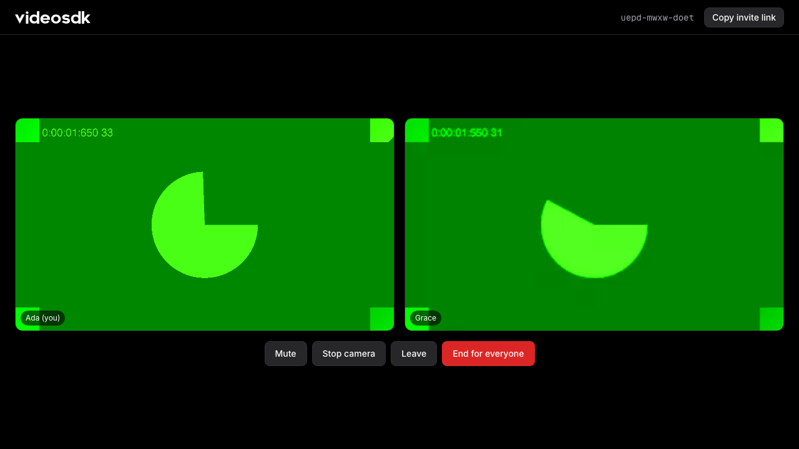
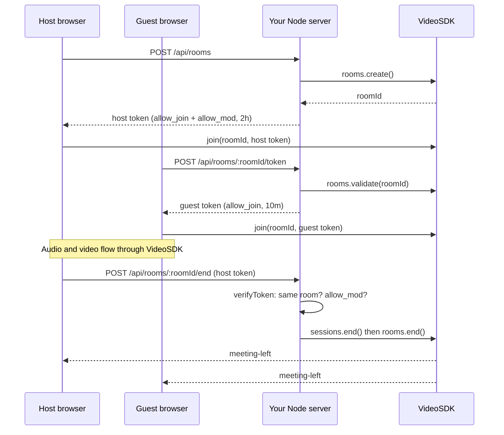

<div align="center">

# WebRTC Video Call App with Node.js

**A group video call where your Express server owns the room. Node creates the room, decides who
gets in, and ends the call for everyone. The browser only joins.**



[](https://videosdk.live) [](https://nodejs.org) [](https://expressjs.com) [](LICENSE)

**[Quick start](#quick-start) · [How it works](#how-it-works) · [Server SDK docs](https://docs.videosdk.live/server-sdk/introduction) · [JavaScript SDK docs](https://docs.videosdk.live/javascript/guide/video-and-audio-calling-api-sdk/quick-start)**

</div>

---

A starting point for any Node.js video chat or video calling app. Clone this repo, add a free API
key from [app.videosdk.live](https://app.videosdk.live), and run it in about 2 minutes.

- **Your server owns the room.** `POST /api/rooms` creates it with the VideoSDK Server SDK. No
  hand-written REST calls, no hand-rolled JWT code.
- **Tokens scoped to one room and one person.** Each token carries a `roomId` and a
  server-generated `participantId`. The host gets `allow_mod` for 2 hours, guests get
  `allow_join` for 10 minutes.
- **End for everyone, from Node.** One endpoint checks that the caller holds the host token for
  this room, ends the live session and disables the room. Every browser is disconnected and the
  link stops working.
- **Zero WebRTC code.** VideoSDK's media cloud carries the audio and video. The browser side is one
  ES module on top of the JavaScript SDK.

## Quick start

You need Node 20.11+ and a free VideoSDK account.

```bash
git clone https://github.com/videosdk-community/videosdk-nodejs-video-calling
cd videosdk-nodejs-video-calling
npm install
cp .env.example .env
```

Open [app.videosdk.live](https://app.videosdk.live), go to **API Keys**, and paste your API key and
secret into `.env`:

```bash
VIDEOSDK_API_KEY=your-api-key
VIDEOSDK_SECRET=your-secret
```

Then start the server:

```bash
npm run dev
```

Open http://localhost:3000, type your name and press **Start call**. Press **Copy invite link** and
open it in a second tab or on another device to join as a guest. Press **End for everyone** in the
host tab and both tabs leave the call.

## How it works



Node never joins the call. It manages rooms and signs tokens; only browsers are participants.

### The server

All of it is in [`server.js`](server.js). Minting a token scoped to one room and one participant:

```js
const token = videosdk
  .accessToken()
  .setParticipant(participantId)
  .forRoom(roomId)
  .grant(Grant.AllowJoin, Grant.AllowMod)
  .expiresIn("2h")
  .toJwt();
```

Ending the call for everyone, only for the host of that room:

```js
const claims = videosdk.verifyToken(req.get("Authorization"));
if (claims.roomId !== roomId || !claims.permissions.includes(Grant.AllowMod)) return 403;

await videosdk.sessions.end({ roomId }); // disconnects everyone in the call
await videosdk.rooms.end(roomId);        // nobody can start it again
```

| Route | What it does |
|---|---|
| `POST /api/rooms` | Creates a room, returns a host token |
| `POST /api/rooms/:roomId/token` | Returns a guest token, or 404 / 410 if the room is unknown or ended |
| `POST /api/rooms/:roomId/end` | Ends the call for everyone. Host token required |

### The browser

[`public/app.js`](public/app.js) asks your server for a token, then joins with the
[JavaScript SDK](https://www.npmjs.com/package/@videosdk.live/js-sdk):

```js
VideoSDK.config(token);
const meeting = VideoSDK.initMeeting({ meetingId: roomId, participantId, name, micEnabled: true, webcamEnabled: true });
await meeting.join();
```

The API secret never reaches the browser. Express serves the SDK from `node_modules`, so there is
no build step.

## Project structure

```
server.js            Express server: rooms, tokens, end for everyone
public/index.html    Join form and call screen
public/app.js        Browser side, on the VideoSDK JavaScript SDK
public/styles.css    Styles on VideoSDK design tokens
docs/DECISIONS.md    How it works and why, in detail
```

## Built with

- [`@videosdk.live/server-sdk`](https://www.npmjs.com/package/@videosdk.live/server-sdk) 0.1.1
- [`@videosdk.live/js-sdk`](https://www.npmjs.com/package/@videosdk.live/js-sdk) 1.2.1
- [Express](https://expressjs.com) 5

## License

[MIT](LICENSE)
